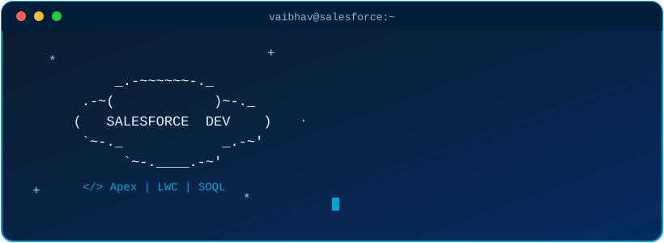

<h1 align="center">Hey, I'm Vaibhav Parkhi ☁️⚡</h1>

<p align="center">
  
</p>

<p align="center">
  
</p>

<p align="center">
  
  
  
</p>

<p align="center">
  
  <a href="https://github.com/vaibhavparkhi?tab=followers">
    
  </a>
</p>

---

## 👨‍💻 About Me, in Apex

```apex
public with sharing class VaibhavParkhi {

    public String role        = 'Salesforce Developer';
    public String superpower  = 'Making Salesforce do exactly what the business needs';
    public List<String> skills = new List<String>{
        'Apex', 'Lightning Web Components', 'SOQL & SOSL',
        'Triggers & Flows', 'REST/SOAP Integrations', 'Salesforce DX'
    };
    public String currentlyLearning = 'Agentforce, Data Cloud and advanced integration patterns';
    public String funFact = 'I read governor limit errors for fun. Okay, not really, but I do respect them.';

    public void startYourDay() {
        System.debug('☕ Coffee loaded. Org connected. Let\'s build something great.');
    }

    public void whenYouNeedMe() {
        // Bulkify it. Test it. Ship it.
        System.debug('Reach out: LinkedIn or email below 👇');
    }
}
```

## 🚀 What I Do

- ⚙️ Build **custom Apex solutions** that are bulkified, tested and governor-limit friendly
- 🎨 Create **Lightning Web Components** that make the UI fast and easy to use
- 🔗 Connect Salesforce with other systems through **REST and SOAP integrations**
- 🤖 Automate processes with **Flows, Process Builder migrations and triggers**
- 🧪 Write **Apex test classes** with strong coverage, not just 75% for the sake of deployment
- 📦 Ship with **Salesforce DX, Git and CI/CD** workflows

## 🛠️ Tech Stack

**Salesforce Platform**


**Web and Tools**


## 🏆 Trailhead and Certifications

<p>
  <a href="https://www.salesforce.com/trailblazer/your-trailblazer-id">
    
  </a>
</p>

- ✅ Platform Developer I: add your status or year
- 🔜 Platform Developer II: add if planned
- 🔜 JavaScript Developer I: add if planned

## 📌 Featured Projects

| Project | What it does | Tech |
| ------- | ------------ | ---- |
| [Project One](https://github.com/vaibhavparkhi/project-one) | One line on the business problem it solves | Apex, LWC |
| [Project Two](https://github.com/vaibhavparkhi/project-two) | One line on the integration or automation | REST API, Flows |
| [Project Three](https://github.com/vaibhavparkhi/project-three) | One line on what makes it special | Apex, Batch, Scheduler |

## 📊 GitHub Stats

<p align="center">
  
  
</p>

<p align="center">
  
</p>

## 💡 My Developer Rules

1. **Bulkify everything.** Triggers should never assume one record.
2. **No SOQL or DML inside loops.** Governor limits are always watching.
3. **Declarative first, code when needed.** The best solution is the simplest maintainable one.
4. **Tests that assert something.** Coverage numbers do not prove quality.
5. **Leave the org cleaner than I found it.**

## 📫 Let's Connect

<p>
  <a href="https://www.linkedin.com/in/your-linkedin-handle"></a>
  <a href="mailto:your.email@example.com"></a>
  <a href="https://trailblazer.me/id/your-trailblazer-id"></a>
</p>

---

<p align="center">
  ☁️ <i>"In Salesforce we trust, in tests we verify."</i> ☁️<br>
  ⭐ Thanks for visiting. Feel free to explore my repositories!
</p>
